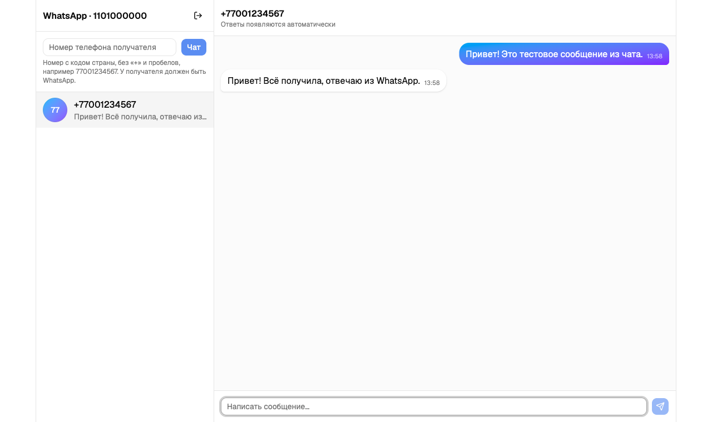

# WhatsApp Chat

Минимальный веб-чат для отправки и получения **текстовых** сообщений в WhatsApp через сервис [GREEN-API](https://green-api.com). Интерфейс — по мотивам мессенджера [MAX](https://web.max.ru/).

Тестовое задание на позицию «Фронтенд-разработчик React». Задание допускает выполнение для WhatsApp, если MAX недоступен: в консоли GREEN-API для региона автора тариф MAX отсутствовал, поэтому использован WhatsApp. Методы `sendMessage`, `receiveNotification` и `deleteNotification` у MAX и WhatsApp совпадают, отличается только проверка номера.

## Скриншоты



Все снимки и проверка по пунктам ТЗ — в [docs/](docs/README.md).

## Возможности

- Вход по `idInstance` и `apiTokenInstance` с проверкой, что инстанс авторизован.
- Создание чата по номеру телефона получателя в международном формате (11–15 цифр; российские `8…` приводятся к `7…`). Наличие WhatsApp у номера проверяется заранее.
- Отправка текстовых сообщений.
- Получение ответов в реальном времени (long-polling HTTP API) и показ их в чате.
- Несколько чатов, список слева, последние активные — сверху.
- История чатов сохраняется между перезагрузками страницы.
- Подсказки на экранах: где взять `idInstance` и токен, как включить приём сообщений, в каком формате вводить номер, что делать дальше.
- Адаптивная вёрстка: на мобильных (< 768px) список чатов и переписка показываются по очереди, на десктопе — рядом.

## Стек

| Область | Технологии |
| --- | --- |
| Фреймворк | React 19, TypeScript |
| Сборка | Vite |
| Стили и UI | Tailwind CSS 4, shadcn/ui (Base UI), lucide-react, sonner |
| HTTP | axios |
| Серверное состояние | TanStack Query (мутации) |
| Клиентское состояние | zustand + persist (localStorage) |
| Формы и валидация | react-hook-form, zod |
| Тесты и линтер | vitest, oxlint |
| Архитектура | Feature-Sliced Design |

## Быстрый старт

Требуется Node.js 20.19+ (или 22.12+).

```bash
git clone <repo-url>
cd green-api
npm install
npm run dev
```

Приложение откроется на <http://localhost:5173>. Переменных окружения нет.

| Команда | Что делает |
| --- | --- |
| `npm run dev` | dev-сервер |
| `npm run build` | проверка типов и production-сборка в `dist/` |
| `npm run preview` | локальный просмотр сборки |
| `npm run lint` | oxlint |
| `npm test` | unit-тесты (vitest) |

## Подготовка аккаунта GREEN-API

1. Зарегистрируйтесь в [консоли GREEN-API](https://console.green-api.com) и создайте инстанс WhatsApp на бесплатном тарифе Developer (до 3 новых чатов в месяц — для проверки достаточно).
2. Привяжите инстанс по QR-коду из консоли: WhatsApp → Связанные устройства → Привязать устройство. Статус должен стать «Авторизован».
3. В настройках инстанса:
   - поле «Адрес отправки уведомлений (URL)» — **пустое** (иначе `ReceiveNotification` вернёт ошибку);
   - «Получать уведомления о входящих сообщениях и файлах» — **Да** (или `setSettings` с `incomingWebhook: "yes"`). Новые настройки применяются в течение ~5 минут.
4. Скопируйте из консоли `idInstance`, `apiTokenInstance` и (при необходимости) `apiUrl`.

## Как пользоваться

1. Откройте приложение, введите `idInstance` и `apiTokenInstance`. Поле `apiUrl` необязательное: по умолчанию хост строится как `https://{первые 4 цифры idInstance}.api.green-api.com` (для `7201…` это `https://7201.api.green-api.com`). Если в консоли указан другой хост — вставьте его.
2. В левой колонке введите номер получателя, например `77001234567`, и нажмите «Чат». Приложение вызовет `checkWhatsapp` и создаст чат с `chatId` вида `77001234567@c.us`. Если у номера нет WhatsApp — появится уведомление.
3. Напишите сообщение и отправьте.
4. Попросите получателя ответить в WhatsApp — ответ появится в чате в течение нескольких секунд.

Кнопка выхода в шапке списка очищает учётные данные и все чаты.

## Используемые методы GREEN-API

Базовый URL: `{apiUrl}/waInstance{idInstance}/{метод}/{apiTokenInstance}`.

| Метод | HTTP | Назначение |
| --- | --- | --- |
| `getStateInstance` | GET | Проверка, что инстанс `authorized`, при входе |
| [`checkWhatsapp`](https://green-api.com/docs/api/service/CheckWhatsapp/) | POST | Проверка, что у номера есть WhatsApp |
| [`sendMessage`](https://green-api.com/docs/api/sending/SendMessage/) | POST | Отправка текста по `chatId` |
| [`receiveNotification`](https://green-api.com/docs/api/receiving/technology-http-api/ReceiveNotification/) | GET | Получение очередного уведомления (`receiveTimeout=5`) |
| [`deleteNotification`](https://green-api.com/docs/api/receiving/technology-http-api/DeleteNotification/) | DELETE | Подтверждение обработки по `receiptId` |

### Как устроено получение сообщений

После входа запускается последовательный цикл:

1. `receiveNotification` ждёт уведомление до 5 секунд; пустой ответ → повтор.
2. Если `typeWebhook === "incomingMessageReceived"` и есть текст — сообщение добавляется в чат с `senderData.chatId` (дубликаты по `idMessage` отбрасываются).
3. `deleteNotification` удаляет уведомление из очереди (иначе придёт снова).
4. При ошибке сети/API — одно уведомление об ошибке и повтор через 5 секунд.

Цикл останавливается при выходе или размонтировании (через `AbortController`).

## Архитектура

Проект организован по методологии [Feature-Sliced Design](https://feature-sliced.design/). Слои импортируют только нижележащие, у каждого слайса есть публичный API в `index.ts`.

```
src/
├── app/                      # инициализация: провайдеры, корневой компонент, глобальные стили
│   ├── providers/
│   ├── styles/index.css
│   └── App.tsx
├── pages/
│   ├── login/                # страница входа
│   └── chat/                 # страница чата (раскладка список + окно)
├── widgets/
│   ├── chat-list/            # шапка, создание чата, список чатов
│   └── chat-window/          # заголовок, сообщения, форма отправки
├── features/
│   ├── auth/                 # LoginForm, LogoutButton, logout
│   ├── create-chat/          # форма номера телефона → checkWhatsapp
│   ├── send-message/         # форма отправки → SendMessage
│   └── receive-messages/     # polling-цикл ReceiveNotification
├── entities/
│   ├── session/              # учётные данные инстанса (store)
│   └── chat/                 # чаты и сообщения (store, MessageBubble, ChatListItem)
└── shared/
    ├── api/                  # клиент GREEN-API и типы
    ├── lib/                  # cn()
    └── ui/                   # компоненты shadcn/ui
```

Алиас `@/` указывает на `src/`.

## Тесты

`npm test` запускает unit-тесты на логику без UI и сети:

- `handleNotification` — разбор входящего уведомления, дедупликация по `idMessage`, игнор не-текстовых и не-входящих событий;
- `phoneSchema` — нормализация и валидация номера телефона;
- стор чатов — создание чата, подъём активного наверх, создание чата по входящему сообщению;
- `defaultApiUrl` и `errorMessage` из клиента GREEN-API.

## Хранение данных и безопасность

- Учётные данные (`wa-chat:session`) и чаты (`wa-chat:chats`) хранятся в `localStorage` браузера. У GREEN-API нет HTTP-метода, который вернул бы историю переписки для такого сценария, поэтому история ведётся на клиенте.
- Токен в браузере — допустимо для тестового задания. В продакшене запросы к GREEN-API нужно проксировать через бэкенд, чтобы не светить `apiTokenInstance`.
- Серверы GREEN-API отдают `Access-Control-Allow-Origin: *`, поэтому прокси для работы из браузера не нужен.

## Ограничения

- Только текстовые сообщения (по условию задания).
- На тарифе Developer доступно 3 новых чата в месяц; при частых проверках `checkWhatsapp` возможны ограничения.
- Если в настройках инстанса включены «идентификаторы чатов» (`@lid`), ответы придут с другим `chatId` и создадут отдельный чат — по умолчанию настройка выключена.
- Сообщения, отправленные с самого телефона (не из этого приложения), в чат не попадают.
- Пока вкладка закрыта, polling не идёт; уведомления хранятся в очереди GREEN-API 24 часа и будут получены при следующем входе.
- Одновременно открытые две вкладки с одним инстансом будут конкурировать за очередь уведомлений.

## Деплой

Это статический SPA: `npm run build`, затем содержимое `dist/` можно выложить на Vercel, Netlify, GitHub Pages или любой статический хостинг. Серверной части и переменных окружения нет.
