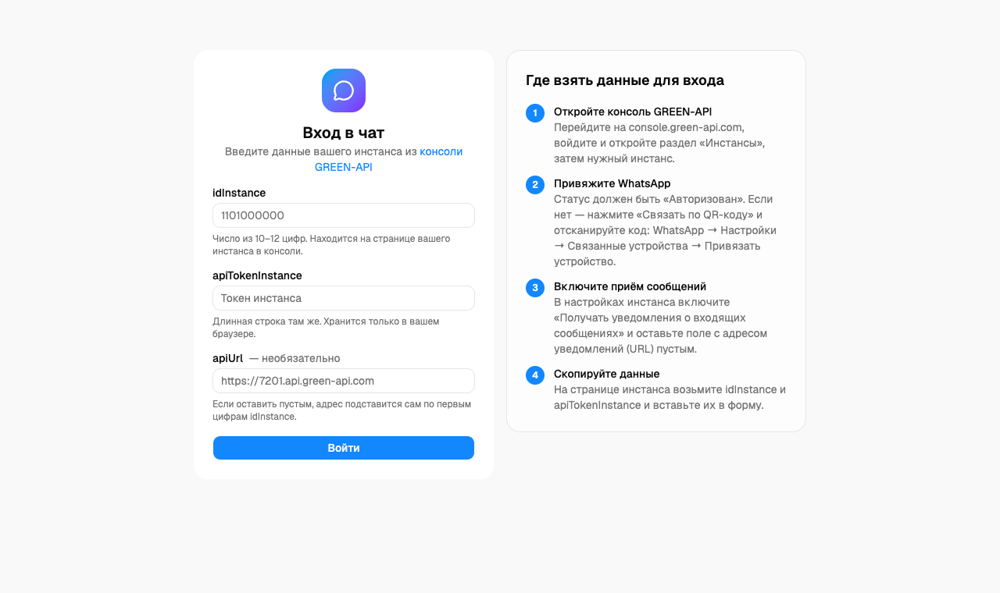
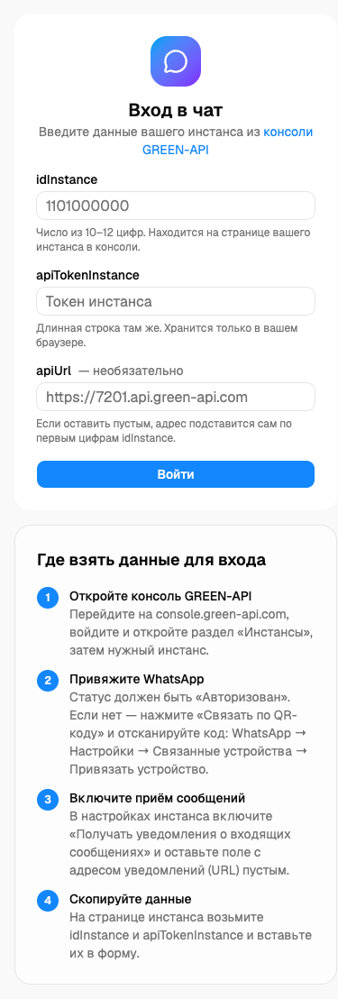
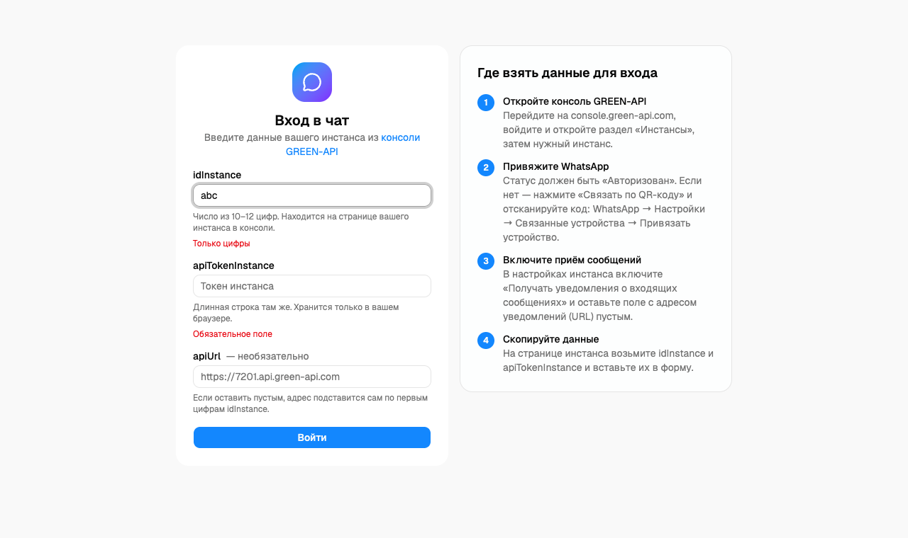
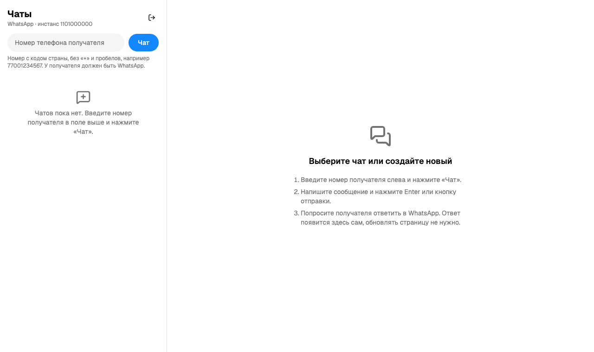
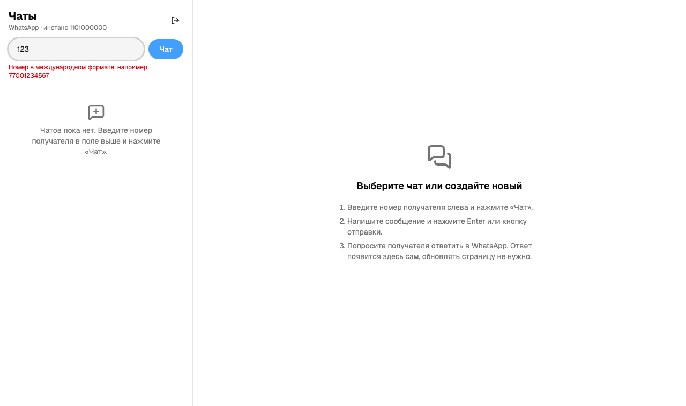
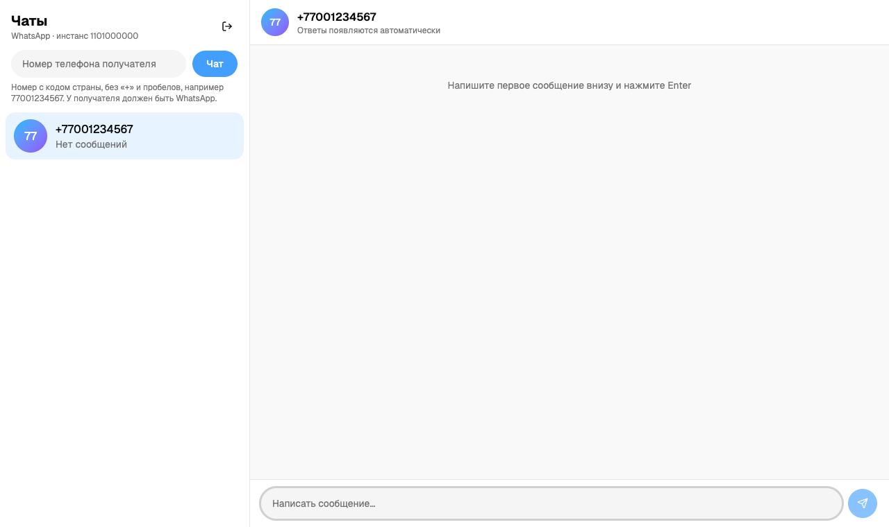
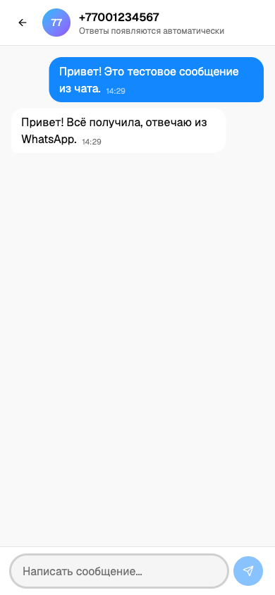
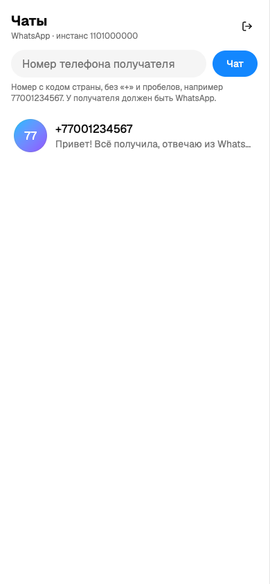

# Документация по тестовому заданию

Скриншоты лежат в [`screenshots/`](screenshots). Сняты в браузере на демо-данных: ответы GREEN-API подменялись заглушками, номер и `idInstance` вымышленные, реальные токены на снимках отсутствуют.

## Проверка требований ТЗ

| № | Требование | Статус | Как выполнено |
| --- | --- | --- | --- |
| 1 | UI для отправки и получения сообщений в MAX | Частично | Сделан для WhatsApp — ТЗ это допускает. В консоли GREEN-API тариф MAX был недоступен. Методы `sendMessage`, `receiveNotification`, `deleteNotification` у MAX и WhatsApp совпадают, отличается только проверка номера (`checkWhatsapp` вместо `checkAccount`) |
| 2 | Использовать сервис GREEN-API | Выполнено | Клиент в `src/shared/api/green.ts` |
| 3 | Только текстовые сообщения | Выполнено | Отправляется только `message`, из уведомлений обрабатывается только `textMessage` |
| 4 | Внешний вид по прототипу web.max.ru | Выполнено | Стиль MAX: светлая тема, синий акцент, двухколоночная раскладка «Чаты + переписка» на всю ширину окна, круглые аватары, поля и кнопка отправки в виде «таблеток», синие исходящие и белые входящие пузыри. Адаптив: на телефоне список и переписка по очереди. Сам чат MAX виден только после входа, поэтому ориентир — открытая часть интерфейса и общий стиль, а не пиксельная копия |
| 5 | Максимально просто, минимум функций | Выполнено | Один экран входа и один экран чата, без лишних функций |
| 6 | Отправка через SendMessage | Выполнено | `POST /sendMessage` — `features/send-message` |
| 7 | Получение через HTTP API (ReceiveNotification) | Выполнено | Цикл `receiveNotification` → обработка → `deleteNotification` — `features/receive-messages` |
| 8 | React | Выполнено | React 19 + TypeScript + Vite |

## Ожидаемый результат

| Шаг сценария | Статус | Скриншот |
| --- | --- | --- |
| Пользователь вводит `idInstance` и `apiTokenInstance` | Выполнено (проверка `getStateInstance`) | [01](screenshots/01-login-desktop.png), [03](screenshots/03-login-validation.png) |
| Вводит номер получателя и создаёт новый чат | Выполнено (`checkWhatsapp`) | [05](screenshots/05-phone-validation.png), [06](screenshots/06-new-chat.png) |
| Пишет сообщение и отправляет | Выполнено | [07](screenshots/07-chat-reply-desktop.png) |
| Получатель отвечает в мессенджере | Внешнее действие | — |
| Пользователь видит ответ в чате | Выполнено (в демо-прогоне ответ подставлен заглушкой) | [07](screenshots/07-chat-reply-desktop.png) |

**Честная оговорка:** сценарий целиком прогнан в браузере на заглушках API, а авторизованность реального инстанса проверена запросом `getStateInstance`. Отправка реального сообщения и реальный ответ с телефона перед сдачей стоит проверить вручную (см. «Контрольная проверка» ниже).

## Что нужно для сдачи (по ТЗ)

Готовый текст письма — в [email.md](email.md).

Письмо на hr@green-api.com, тема: **Тестовое задание на должность - Фронтенд разработчик React**.

1. Резюме в PDF, в тексте — Telegram для связи.
2. Репозиторий GitHub: <https://github.com/WebDiyar/green-api-tz>
3. Инструкция запуска: [раздел «Быстрый старт» в README](../README.md#быстрый-старт), на GitHub — <https://github.com/WebDiyar/green-api-tz#быстрый-старт>
4. Сервис в интернете: <https://green-api-tz-blue.vercel.app>
5. Скриншоты — эта папка; видео-презентация (при наличии).
6. Предпочитаемый формат работы: удалёнка / офис Химки / офис Астана.

## Контрольная проверка перед отправкой

1. Войти реальными `idInstance` и `apiTokenInstance`.
2. Создать чат с номером, к которому есть доступ (на тарифе Developer — не более 3 новых чатов в месяц).
3. Отправить сообщение — оно должно прийти на телефон получателя.
4. Ответить с телефона — ответ появится в чате в течение нескольких секунд.

## Скриншоты

### Вход

| Десктоп | Мобильный | Валидация |
| --- | --- | --- |
|  |  |  |

### Чат (десктоп)

| Пустое состояние с подсказками | Ошибка в номере | Новый чат |
| --- | --- | --- |
|  |  |  |

### Переписка

### Мобильная версия

| Переписка | Список чатов |
| --- | --- |
|  |  |
